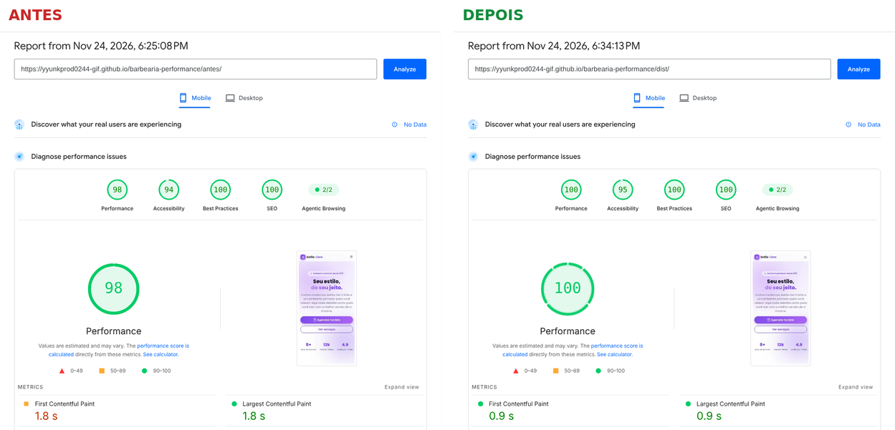
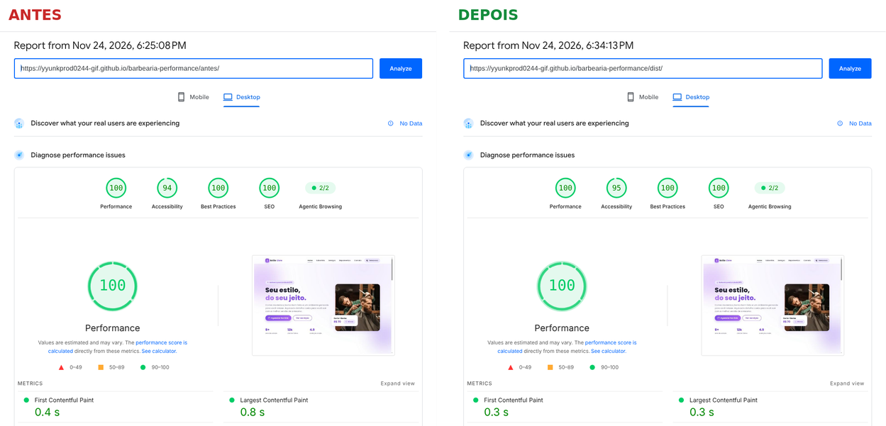
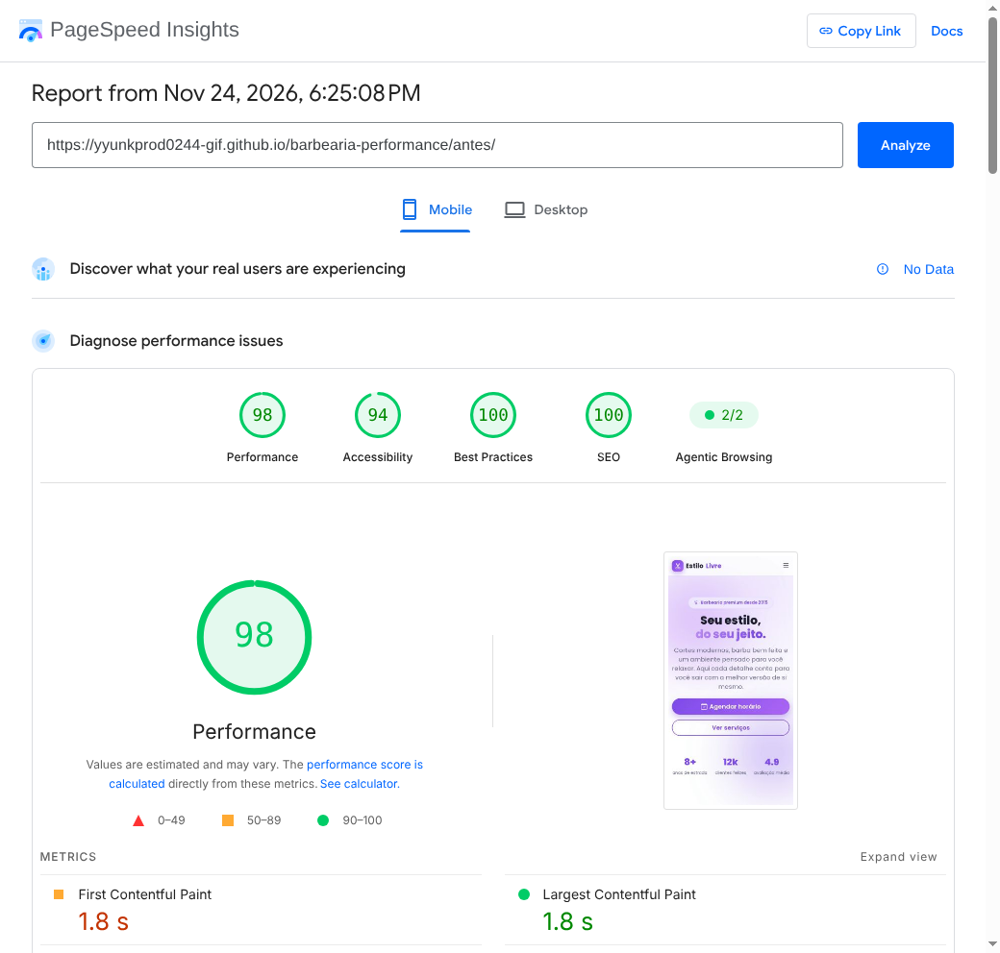
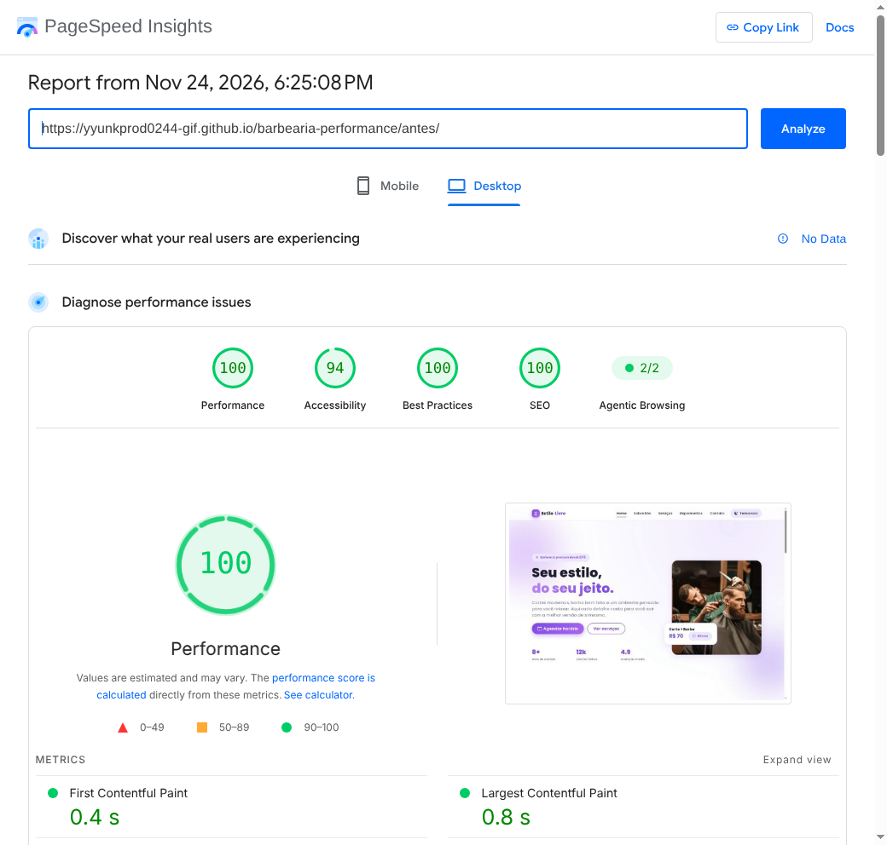
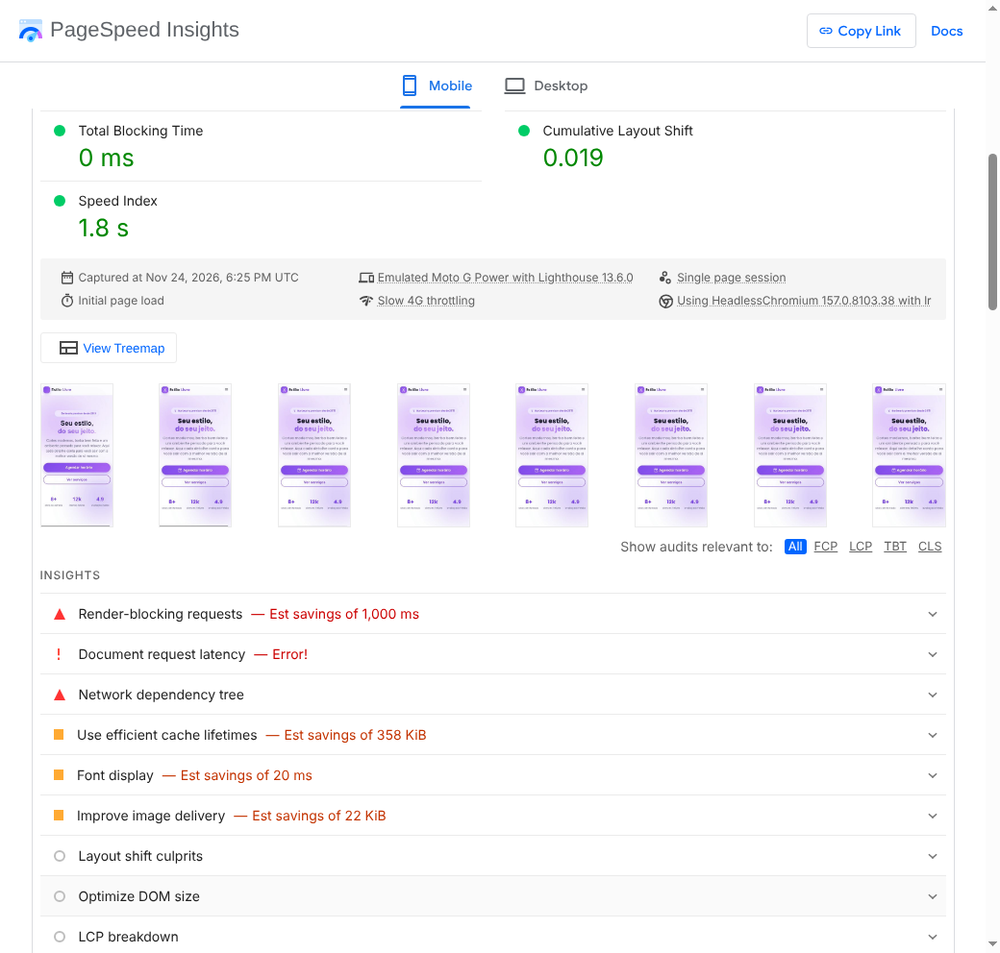
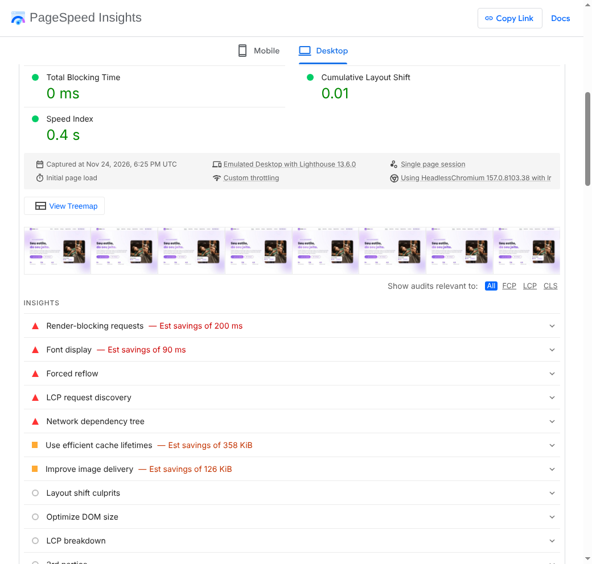
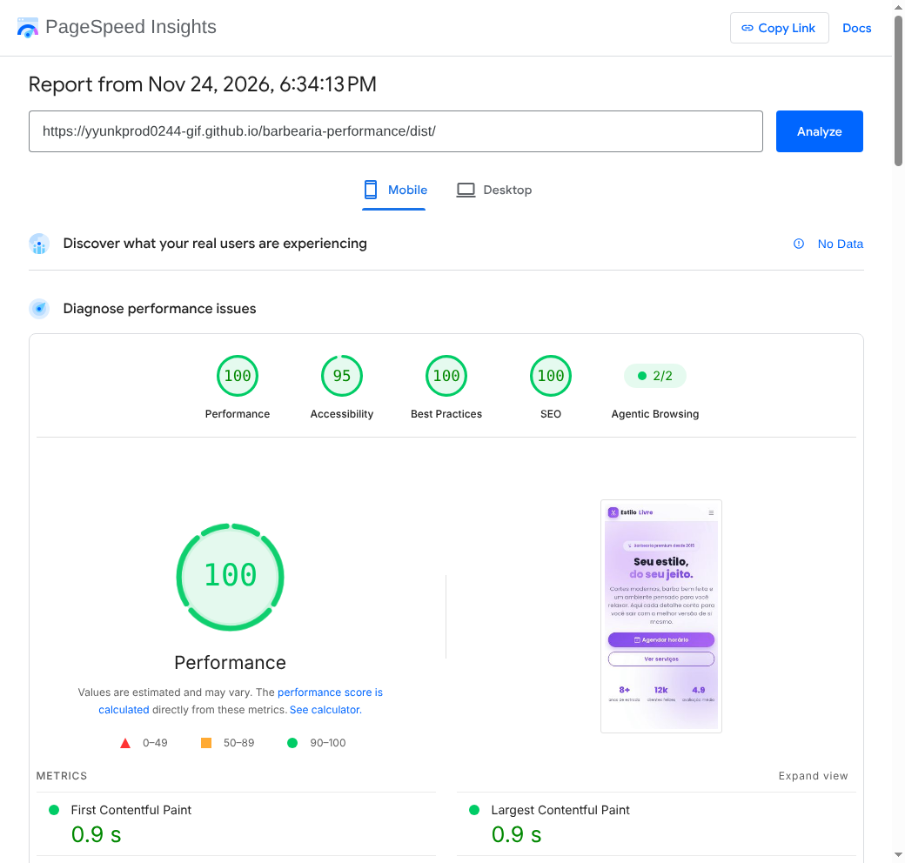
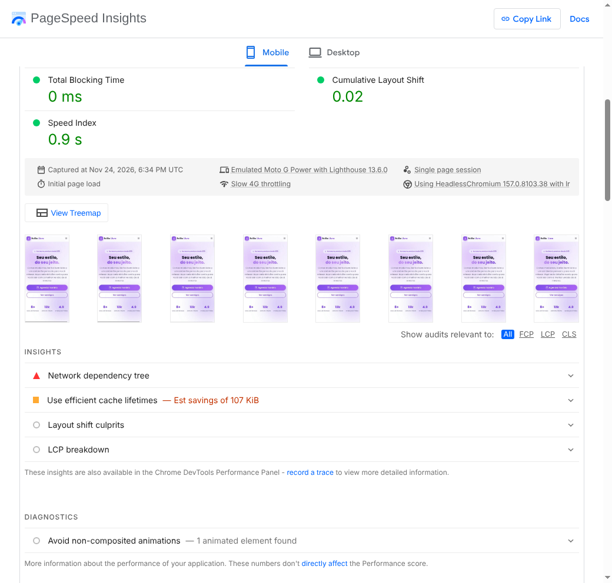
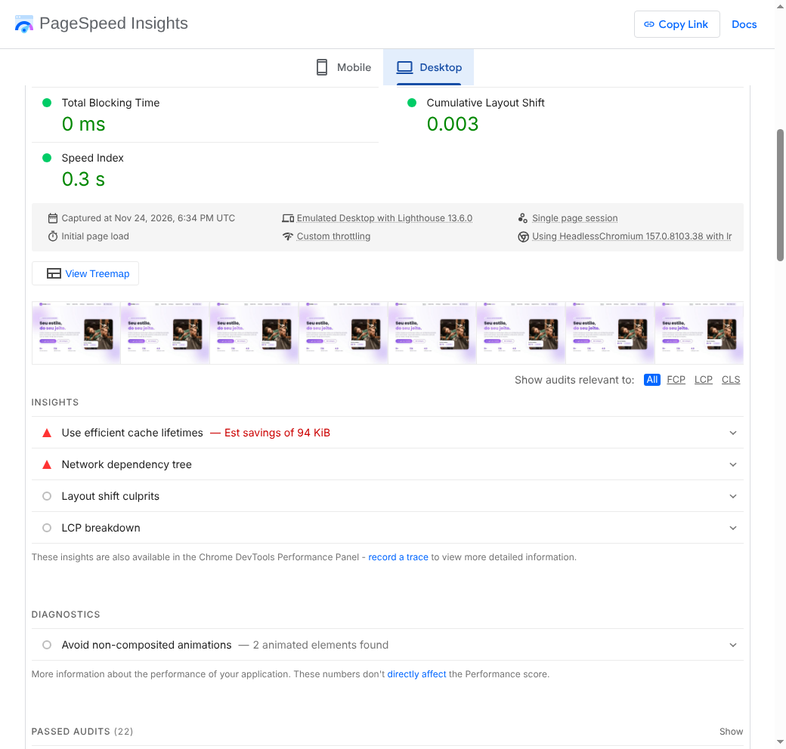

# Estilo Livre — Análise e otimização de performance

Exercício de **diagnóstico e otimização de performance web**: o site da barbearia fictícia **Estilo Livre** (feito no exercício de Bootstrap) foi analisado com o **Lighthouse** (via PageSpeed Insights), otimizado e analisado de novo. Os relatórios foram feitos nas mesmas condições, para comparar as duas versões.

| | Link |
| --- | --- |
| Site **antes** (original) | https://yyunkprod0244-gif.github.io/barbearia-performance/antes/ |
| Site **depois** (otimizado) | https://yyunkprod0244-gif.github.io/barbearia-performance/dist/ |
| Relatório Lighthouse **antes** | [PDF](relatorios/relatorio-antes.pdf) · [prints](relatorios/antes) · [online](https://pagespeed.web.dev/analysis/https-yyunkprod0244-gif-github-io-barbearia-performance-antes/jmh6yjo1t30nghjqvo072g) |
| Relatório Lighthouse **depois** | [PDF](relatorios/relatorio-depois.pdf) · [prints](relatorios/depois) · [online](https://pagespeed.web.dev/analysis/https-yyunkprod0244-gif-github-io-barbearia-performance-dist/ihus6hzhbnrlj1b3nahcji) |

> O visual e o comportamento do site são os mesmos nas duas versões: tema branco/roxo, menu mobile, carrossel de depoimentos, formulário com validação e botão de voltar ao topo. A diferença está toda no que é baixado, e em como.

---

## Sumário

1. [Resultado em uma tabela](#1-resultado-em-uma-tabela)
2. [Sobre o projeto](#2-sobre-o-projeto)
3. [Como os testes foram feitos](#3-como-os-testes-foram-feitos)
4. [Relatório inicial e gargalos identificados](#4-relatório-inicial-e-gargalos-identificados)
5. [Melhorias aplicadas](#5-melhorias-aplicadas)
6. [Relatório final e comparativo](#6-relatório-final-e-comparativo)
7. [O que trouxe mais impacto](#7-o-que-trouxe-mais-impacto)
8. [Um achado no caminho: o preload de fontes](#8-um-achado-no-caminho-o-preload-de-fontes)
9. [O que ainda dá para melhorar](#9-o-que-ainda-dá-para-melhorar)
10. [Estrutura de pastas e como rodar](#10-estrutura-de-pastas-e-como-rodar)

---

## 1. Resultado em uma tabela

**Lighthouse 13.6.0 — Mobile** (Moto G Power emulado, rede Slow 4G)

| Métrica | Antes | Depois | Variação |
| --- | ---: | ---: | --- |
| **Performance** | 98 | **100** | +2 |
| First Contentful Paint (FCP) | 1,8 s | **0,9 s** | −50% |
| Largest Contentful Paint (LCP) | 1,8 s | **0,9 s** | −50% |
| Speed Index | 1,8 s | **0,9 s** | −50% |
| Total Blocking Time (TBT) | 0 ms | 0 ms | = |
| Cumulative Layout Shift (CLS) | 0,019 | 0,02 | ≈ (ver [seção 9](#9-o-que-ainda-dá-para-melhorar)) |
| Acessibilidade | 94 | 95 | +1 |

**Lighthouse 13.6.0 — Desktop**

| Métrica | Antes | Depois | Variação |
| --- | ---: | ---: | --- |
| **Performance** | 100 | **100** | = |
| First Contentful Paint (FCP) | 0,4 s | **0,3 s** | −25% |
| Largest Contentful Paint (LCP) | 0,8 s | **0,3 s** | −63% |
| Speed Index | 0,4 s | **0,3 s** | −25% |
| Cumulative Layout Shift (CLS) | 0,01 | **0,003** | −70% |

**Peso e requisições da página no celular** (medido no Chrome com a mesma limitação de rede e CPU; ver [seção 3](#3-como-os-testes-foram-feitos))

| | Antes | Depois | Redução |
| --- | ---: | ---: | ---: |
| Dados transferidos | 625 KB | **90 KB** | −86% |
| Requisições | 23 | **9** | −61% |
| Domínios acessados | 3 | **1** | −67% |
| CSS que bloqueia a renderização | 4 arquivos (48 KB) | **0** | −100% |
| JavaScript | 25 KB | **2 KB** | −92% |
| Imagens | 380 KB (9) | **33 KB (2)** | −91% |
| Fontes | 167 KB (6) | **39 KB (5)** | −77% |





---

## 2. Sobre o projeto

**Estilo Livre** é a landing page de uma barbearia fictícia com as seções Home, Sobre nós, Serviços, Depoimentos (carrossel) e Contato (formulário com validação), além de um botão para alternar entre o tema branco e o roxo.

A versão original (pasta [`antes/`](antes)) foi feita com:

- **Bootstrap 5.3.3** completo, por CDN (CSS de 227 KB e `bootstrap.bundle.min.js` de 80 KB, que inclui o Popper);
- **Bootstrap Icons**, por CDN (CSS de 98 KB e fonte de 130 KB, com cerca de 2.000 ícones, dos quais a página usa 21);
- **Google Fonts** (Poppins em 5 pesos);
- 9 imagens `.webp` em tamanho cheio, sem `width`/`height` e sem lazy loading.

O site já era razoavelmente rápido, porque usava WebP e tinha poucos scripts. Por isso o objetivo foi **tirar o que sobrava**: bibliotecas inteiras para usar poucas partes, arquivos de outros domínios e imagens maiores do que o tamanho em que aparecem na tela.

---

## 3. Como os testes foram feitos

- **Ferramenta principal:** [PageSpeed Insights](https://pagespeed.web.dev/), que roda o **Lighthouse 13.6.0**, nos perfis Mobile e Desktop.
- **Mesmas condições:** as duas versões estão publicadas no **mesmo GitHub Pages**, no mesmo repositório (`/antes/` e `/dist/`). Assim, servidor, cache e compressão são iguais, e a única diferença é o código.
- **Medição complementar** (a tabela de peso e requisições): o Chrome foi controlado pelo protocolo do DevTools, o mesmo usado pela aba *Performance* e pela aba *Network*. A configuração imita o celular do Lighthouse: tela de 412 px, rede de 1,6 Mbps com 150 ms de latência, CPU 4× mais lenta e cache desativado. Cada versão foi medida 3 vezes, e a tabela mostra a mediana.
- **Conferência visual e funcional:** foram tiradas capturas da página inteira das duas versões (desktop e mobile, nos dois temas), comparadas pixel a pixel. A diferença ficou abaixo de 0,6%, só em suavização de bordas. Também foi feito um teste automatizado de menu mobile, troca de tema, carrossel (setas, indicadores e avanço automático), validação e envio do formulário, e botão de voltar ao topo.

---

## 4. Relatório inicial e gargalos identificados

📄 [relatorios/relatorio-antes.pdf](relatorios/relatorio-antes.pdf)

| Mobile | Desktop |
| --- | --- |
|  |  |
|  |  |

Os gargalos apontados pelo Lighthouse, e o que estava por trás de cada um:

| # | Gargalo (Lighthouse) | Causa no código |
| --- | --- | --- |
| 1 | **Requisições que bloqueiam a renderização**, com economia estimada de **1.000 ms** no mobile e 200 ms no desktop | Três CSS em outros domínios (`bootstrap.min.css`, `bootstrap-icons.css` e o CSS do Google Fonts) mais o `style.css`. O navegador não desenha nada até baixar todos. |
| 2 | **Reduzir CSS não usado**: 31 KiB | Bootstrap inteiro (227 KB) para usar grid, navbar, card, carrossel e formulário. O Bootstrap Icons traz CSS para cerca de 2.000 ícones. |
| 3 | **Melhorar a entrega de imagens**: 22 KiB no mobile e 126 KiB no desktop | Imagens maiores que o espaço em que aparecem. Por exemplo, `cliente3.webp` tem 860×860 px e 147 KB para um avatar de 70×70 px, e `corte.webp` tem 736×1104 px para uma faixa de 180 px de altura. |
| 4 | **Exibição de fontes**: 20 ms no mobile e 90 ms no desktop | A fonte de ícones e a Poppins vinham de outros domínios, só eram descobertas depois do CSS e não tinham controle de exibição. |
| 5 | **Descoberta da imagem LCP** e **reflow forçado** (desktop) | A foto do topo não tinha prioridade (`fetchpriority`). O `bootstrap.bundle` lê medidas do layout na inicialização. |
| 6 | **Tarefa longa na thread principal** (mobile) | Execução do `bootstrap.bundle.min.js` (80 KB, com o Popper, que a página nem usa). |
| 7 | **Terceiros** e **árvore de dependências de rede** | Três domínios (`cdn.jsdelivr.net`, `fonts.googleapis.com` e `fonts.gstatic.com`), cada um com sua própria conexão (DNS, TCP e TLS). |
| 8 | Imagens sem `width`/`height` e sem `loading="lazy"` (CLS de 0,019) | Todas as 9 imagens eram baixadas logo de início, inclusive as que ficam escondidas no carrossel e a foto do topo, que nem aparece no celular. |

---

## 5. Melhorias aplicadas

Todas as mudanças estão em [`src/`](src), o código legível. Os scripts em [`scripts/`](scripts) geram a versão final minificada em [`dist/`](dist).

### 5.1 Imagens: redimensionamento, AVIF + WebP e lazy loading

Script: [`scripts/otimizar-imagens.mjs`](scripts/otimizar-imagens.mjs), que usa o **sharp**.

- Cada imagem foi **redimensionada para o tamanho em que aparece**, com 2× para telas de alta densidade: avatares em 140×140 px e cards em 320 e 640 px de largura, recortados em 16:10, que é a mesma faixa que o `object-fit: cover` já mostrava.
- Duas versões de cada imagem: **AVIF** (mais leve) e **WebP** (para navegadores sem AVIF), dentro de um `<picture>` com `srcset` e `sizes`. Assim, o navegador escolhe o formato e o tamanho certos.
- **`loading="lazy"`** e `decoding="async"` em todas as imagens abaixo da primeira tela.
- **`width` e `height`** em todas as imagens, para o navegador reservar o espaço antes de baixá-las e o layout não pular.
- Foto do topo: **`fetchpriority="high"`** no desktop. No celular, onde ela fica oculta, um `<source media>` entrega um GIF de 1 px, então **a foto não é baixada**.

| Imagens | Antes | Depois |
| --- | ---: | ---: |
| Todas, no maior tamanho | 378 KB | 87 KB (AVIF) |
| Baixadas na primeira visita, no celular | 380 KB (9 imagens) | **33 KB (2 imagens)** |

### 5.2 Bootstrap trocado por uma versão enxuta (CSS)

Script: [`scripts/purgar-bootstrap.mjs`](scripts/purgar-bootstrap.mjs), que segue a mesma ideia do PurgeCSS, sem dependências.

1. Lê todas as classes e tags usadas no HTML, mais as classes que o JS adiciona (`show`, `collapsing`, `carousel-item-next` etc.).
2. Mantém apenas as regras do Bootstrap cujas classes existem na página.
3. Remove as variáveis `--bs-*` e os `@keyframes` que ninguém usa.

**Resultado: de 227 KB para 25 KB** (−89%), com o mesmo visual.

### 5.3 `bootstrap.bundle.min.js` trocado por JavaScript próprio

A página usava o JS do Bootstrap só para o **menu colapsável** e o **carrossel**. Os dois foram reescritos em JavaScript puro em [`src/js/script.js`](src/js/script.js), reaproveitando as classes de animação do próprio Bootstrap (`collapsing`, `carousel-item-start` etc.). O carrossel ganhou de quebra: pausa quando a aba não está visível, gesto de deslizar no celular, navegação pelo teclado e só começa a girar quando aparece na tela.

**Resultado: de 80 KB para 5,6 KB** minificado (1,9 KB com gzip) e **sem tarefas longas**. O script também passou a usar `defer`, e o evento de rolagem ficou `passive` e com `requestAnimationFrame`.

### 5.4 Fonte de ícones trocada por um sprite SVG

Script: [`scripts/gerar-icones.mjs`](scripts/gerar-icones.mjs). Em vez de baixar o CSS (98 KB) e a fonte (130 KB) do Bootstrap Icons, a página leva **um sprite SVG embutido só com os 21 ícones usados** (cerca de 4 KB com gzip). Cada `<i class="bi bi-scissors">` virou `<svg class="bi"><use href="#bi-scissors"/></svg>`.

**Resultado: 2 requisições e cerca de 228 KB a menos**, ícones sempre nítidos e nenhum "piscar" de fonte nos ícones.

### 5.5 Fonte Poppins hospedada no próprio projeto

Os 5 pesos da Poppins (400 a 800) passaram a ficar no repositório, em **woff2 com subconjunto latino** (cerca de 8 KB cada, já com acentos), com `@font-face` e `font-display: swap`. Isso elimina duas conexões extras (`fonts.googleapis.com` e `fonts.gstatic.com`) e um CSS que bloqueava a renderização.

### 5.6 Minificação de HTML, CSS e JS

Script: [`scripts/build.mjs`](scripts/build.mjs), que usa o **esbuild**.

| Arquivo | Original | Minificado | Com gzip |
| --- | ---: | ---: | ---: |
| CSS (Bootstrap enxuto + `style.css`) | 37,7 KB | 33,6 KB | 7,3 KB |
| `js/script.js` | 9,4 KB | 5,6 KB | 1,9 KB |
| `index.html` (com o CSS embutido) | 68,6 KB | 63,0 KB | 15,5 KB |

Além de minificar, o build **embute o CSS no `<head>`**: a página inteira chega na primeira resposta, sem nenhum CSS bloqueando a renderização. Com 7 KB comprimidos, embutir sai mais barato do que fazer mais uma requisição.

### 5.7 Remoção de código não utilizado

- **CSS morto do projeto:** os blocos `.hero-card-icon`, `.about-visual` e `.about-box-1/2/3` (e a regra de media query correspondente), sobras de uma versão anterior da seção "Sobre" que já não existia no HTML.
- **JS morto:** o seletor `.about-visual` na animação de entrada e a dependência do objeto global `bootstrap`.
- **Bibliotecas:** cerca de 89% do CSS do Bootstrap, todo o JS do Bootstrap e do Popper, e cerca de 1.980 ícones nunca usados (itens 5.2 a 5.4).

### 5.8 Ajustes de acessibilidade aproveitados no caminho

- `prefers-reduced-motion`: quem pede menos movimento no sistema não vê as animações contínuas.
- As estrelas dos depoimentos ganharam um rótulo para leitores de tela ("Avaliação: 4,5 de 5 estrelas").

---

## 6. Relatório final e comparativo

📄 [relatorios/relatorio-depois.pdf](relatorios/relatorio-depois.pdf)

| Mobile | Desktop |
| --- | --- |
|  |  |
|  |  |

**O que sumiu do relatório:** requisições bloqueando a renderização, CSS não usado, entrega de imagens, exibição de fontes, descoberta da imagem LCP, reflow forçado, tarefa longa e terceiros.

**O que continua:** "cache lifetimes" (explicado na seção 9) e uma animação não composta (o degradê animado do título).

As tabelas completas estão na [seção 1](#1-resultado-em-uma-tabela).

---

## 7. O que trouxe mais impacto

1. **Embutir o CSS e tirar os CSS de outros domínios** (Bootstrap enxuto + sprite de ícones + fonte local). Foi o que **cortou o FCP e o LCP pela metade no mobile (1,8 s → 0,9 s)**. Antes, o navegador precisava abrir conexões com três domínios e baixar quatro CSS antes de desenhar qualquer coisa. Agora ele desenha com a primeira resposta do servidor. Era o maior gargalo do relatório inicial: 1.000 ms de economia estimada.
2. **Imagens no tamanho certo + AVIF + lazy loading.** Foi o maior ganho em **bytes**: de 380 KB para 33 KB na primeira visita pelo celular. No desktop, a foto do topo com `fetchpriority="high"` levou o **LCP de 0,8 s para 0,3 s**. Os atributos `width` e `height` baixaram o CLS do desktop de 0,01 para 0,003.
3. **Trocar o `bootstrap.bundle` por JS próprio.** Foram 78 KB a menos e o fim da tarefa longa e do reflow forçado. Como o TBT já era 0, o efeito na nota foi pequeno. Num celular mais fraco ou numa página com mais scripts, seria o item mais importante.
4. **Minificação.** Teve o menor impacto isolado (cerca de 10% sobre o que já tinha sido enxugado), porque o gzip do servidor já comprime boa parte dos espaços. Mesmo assim, vale a pena porque não custa nada depois que o build está pronto.

---

## 8. Um achado no caminho: o preload de fontes

Na primeira versão otimizada, as fontes tinham `<link rel="preload">`, que é uma recomendação comum. O relatório deu FCP e LCP de 0,9 s, mas **Speed Index de 3,7 s**, pior que o original. Nas medições locais com limitação de rede, o Speed Index era de cerca de 0,6 s.

Testes feitos para entender:

| Tentativa | Speed Index (mobile) |
| --- | ---: |
| Preload de 2 pesos (400 e 800) | 3,7 s |
| Preload dos 5 pesos (eliminou a cadeia HTML → fonte apontada pelo Lighthouse) | 3,7 s |
| **Sem preload** (fontes carregadas pelo `@font-face`, com `font-display: swap`) | **0,9 s** |

No Chrome usado pelo PageSpeed (HeadlessChromium 157), fontes com preload **aparentemente seguraram a primeira pintura** da página: nas capturas do relatório, metade dos quadros aparecia em branco. Sem o preload, o texto aparece na hora com a fonte do sistema e troca para a Poppins assim que ela chega. Fica o aprendizado: **toda otimização precisa ser medida**, porque uma "boa prática" pode piorar o resultado.

---

## 9. O que ainda dá para melhorar

- **"Use efficient cache lifetimes" (107 KiB):** o GitHub Pages envia `Cache-Control: max-age=600` (10 minutos) para todos os arquivos, e isso não pode ser mudado pelo código. Numa hospedagem como Netlify ou Vercel, daria para colocar cache de 1 ano nas imagens e fontes (com o nome do arquivo versionado).
- **CLS de 0,02 no mobile:** vem da troca da fonte do sistema pela Poppins (`font-display: swap`). Dá para zerar com uma fonte reserva ajustada (`size-adjust` e `ascent-override` no `@font-face`) ou com `font-display: optional`.
- **Animação não composta:** o degradê animado de "do seu jeito." muda `background-position`, o que obriga o navegador a redesenhar o texto a cada quadro. Foi mantida por ser parte do design. Uma alternativa seria animar um pseudo-elemento com `transform`.
- **Acessibilidade (95):** os títulos pulam níveis (h1 → h5/h6) e os indicadores do carrossel têm só 10 px de área de toque. Corrigir isso exige mudar o visual, então ficou fora deste exercício de performance.

---

## 10. Estrutura de pastas e como rodar

```
barbearia-performance/
├── antes/                     # versão ORIGINAL, sem alterações (relatório "antes")
│   ├── index.html
│   ├── css/style.css
│   ├── js/script.js
│   └── img/                   # 9 imagens .webp originais
├── src/                       # código-fonte OTIMIZADO (legível, comentado)
│   ├── index.html             # <picture>, lazy loading, sprite SVG, sem CDNs
│   ├── css/
│   │   ├── bootstrap-enxuto.css   # gerado por scripts/purgar-bootstrap.mjs
│   │   └── style.css              # estilos do projeto, sem código morto
│   ├── js/script.js           # tema, menu e carrossel em JS puro
│   ├── fonts/                 # Poppins woff2 (latin), 5 pesos
│   └── img/                   # AVIF + WebP redimensionados (gerados)
├── dist/                      # BUILD final minificado (relatório "depois")
├── scripts/
│   ├── otimizar-imagens.mjs   # sharp: redimensiona e gera AVIF/WebP
│   ├── gerar-icones.mjs       # monta o sprite SVG só com os ícones usados
│   ├── purgar-bootstrap.mjs   # Bootstrap só com as regras usadas
│   └── build.mjs              # esbuild: minifica JS/CSS, embute CSS, minifica HTML
├── relatorios/
│   ├── relatorio-antes.pdf
│   ├── relatorio-depois.pdf
│   ├── comparativo-mobile.png
│   ├── comparativo-desktop.png
│   ├── antes/                 # prints do PageSpeed (mobile e desktop)
│   └── depois/
├── index.html                 # redireciona para dist/
└── package.json
```

**Para gerar tudo de novo** (Node.js 18 ou mais recente):

```bash
npm install
npm run tudo     # imagens -> ícones -> bootstrap enxuto -> build
npm start        # serve a pasta dist/ em http://localhost:3000
```

Também dá para rodar cada etapa separada: `npm run imagens`, `npm run icones`, `npm run bootstrap` e `npm run build`.

---

© 2026 Douglas Henrique.
